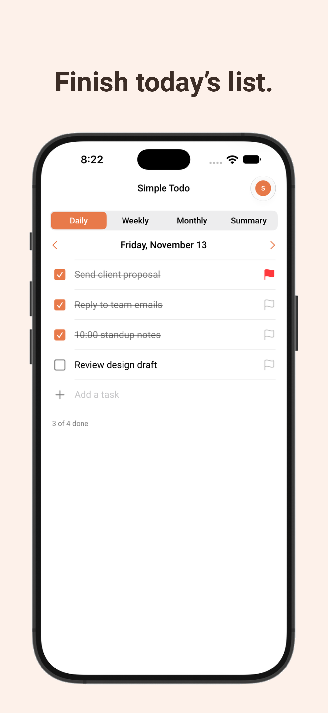
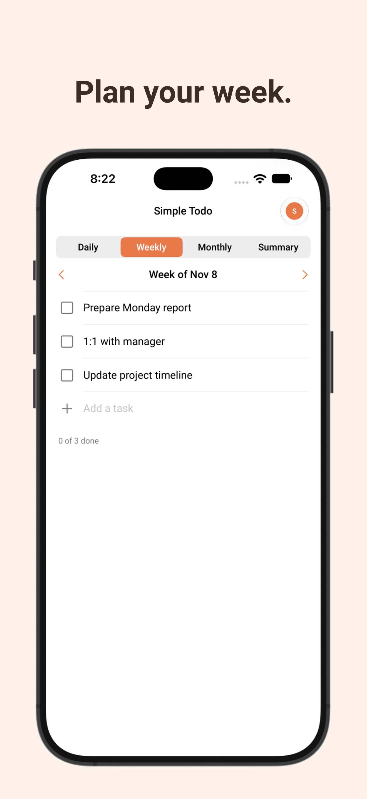
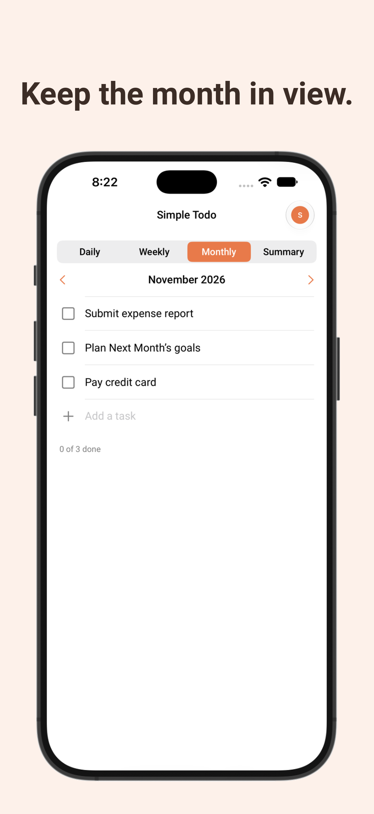
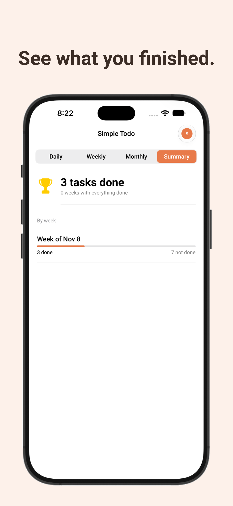
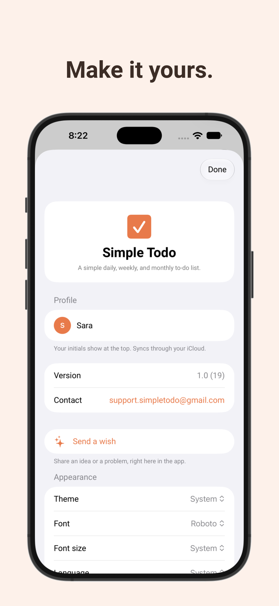
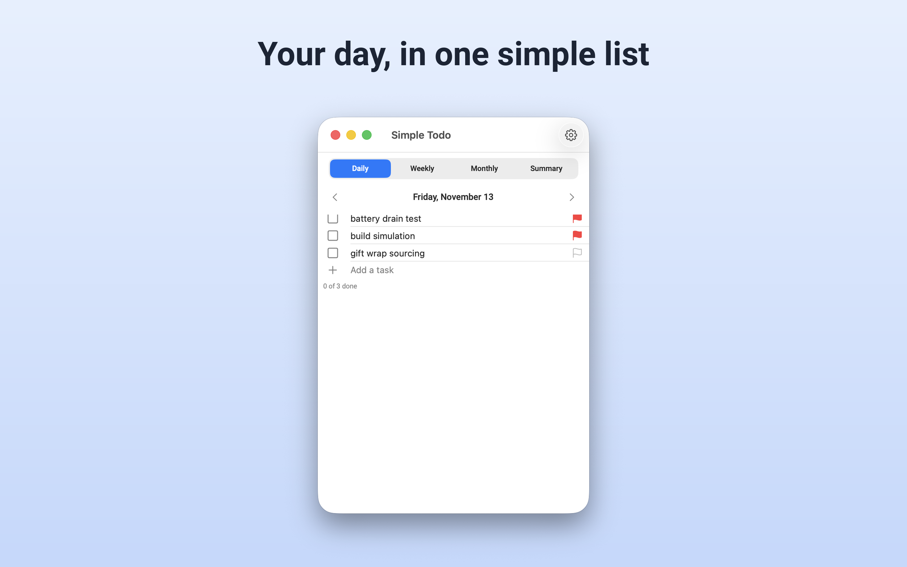

# Simple Todo: Daily Task — Feature Guide

A simple daily, weekly, and monthly to-do list. Like a paper booklet.
Works on iPhone, iPad, and Mac.

---

## 1. Your lists: Daily, Weekly, Monthly

- Tap **Daily**, **Weekly**, or **Monthly** at the top.
- Tap **Add a task** and type. Press Return to add it.
- Tap the arrows **‹ ›** to see past or future pages.
- The line under the list shows how many are done, like "3 of 4 done".

## 2. Check off a task

- Tap the box next to a task. It gets a check and a line through it.
- Tap again to undo.
- Finished tasks stay on the day you finished them.

## 3. Unfinished tasks move forward

- At midnight, unfinished tasks move on their own.
- Daily → next day. Weekly → next week. Monthly → next month.
- This works even if the app stays open.

## 4. Urgent flag (Daily only)

- Tap the flag on the right of a daily task. It turns red.
- Urgent tasks move to the top of the list.
- Tap the red flag again to remove it.

## 5. Move a task

- iPhone or iPad: long-press the task.
- Mac: right-click the task.
- Choose **Move to Daily**, **Move to Weekly**, or **Move to Monthly**.
- The task goes to the end of that list.
- The urgent flag is removed when a task leaves Daily.

## 6. Edit or delete a task

- Edit: tap the task text and type.
- Delete: swipe left, then tap **Delete**. Or erase all the text.

## 7. Summary

- Tap **Summary** at the top.
- See how many tasks you finished in total.
- See each week: done and not done, past weeks too.
- Weeks where you finished everything are counted at the top.

## 8. Settings

Open Settings:
- iPhone or iPad: tap the round button at the top right.
- Mac: **Simple Todo → Settings…**, or press ⌘ and comma (⌘,).

In Settings:
- **Profile — Your name:** your initials show at the top. Syncs through your iCloud.
- **Version:** the app version.
- **Contact:** the support email.
- **Send a wish:** send an idea or a problem, right in the app.
- **Appearance:**
  - **Theme:** System, Light, or Dark.
  - **Font:** Roboto, Lato, or Open Sans.
  - **Font size:** System or a custom size.
  - **Language:** System, English, or 繁體中文.
- **Tip jar:** optional tips. Tips unlock nothing.
- **iCloud sync:** shows if your list is syncing.

## 9. Sync between devices

- Sign in to the same Apple ID on each device, with iCloud on.
- Your list syncs on its own. No sign-up, no login.
- Changes usually show on other devices within about a minute.
- Check the status in **Settings → iCloud sync**.

## 10. Privacy

- No account. No ads. No tracking.
- Your tasks stay on your device and in your own iCloud.
- The developer cannot see your tasks.
- Full policy: https://sites.google.com/view/simpletodo-journipod/privacy-policy

## 11. Help

- In the app: **Settings → Send a wish**
- Email: support.simpletodo@gmail.com
- Support page: https://sites.google.com/view/simpletodo-journipod/support

© 2026 Simple Todo by Journipod
