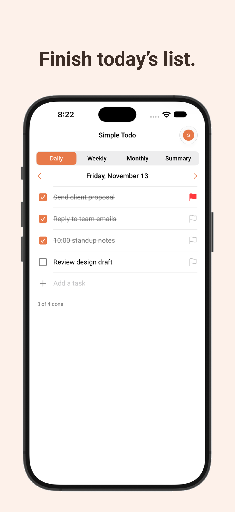
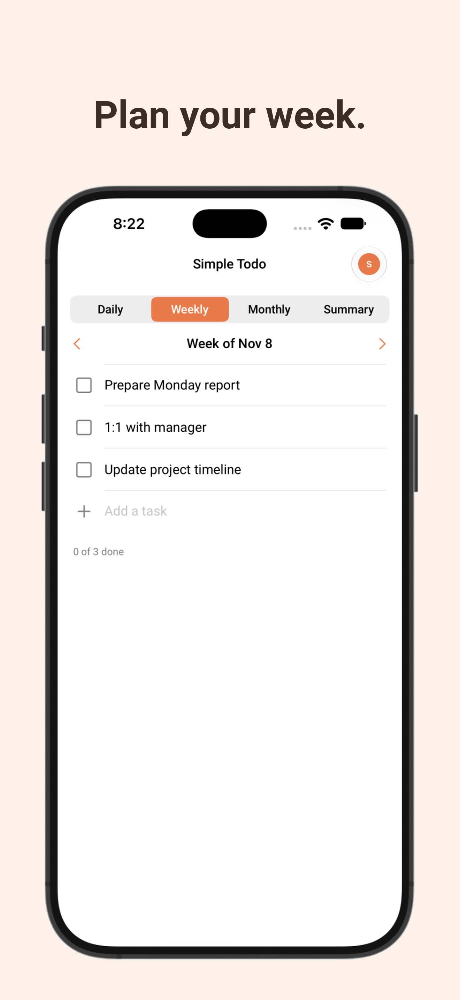
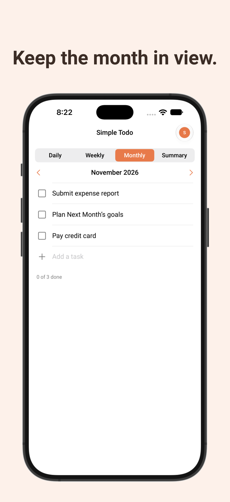
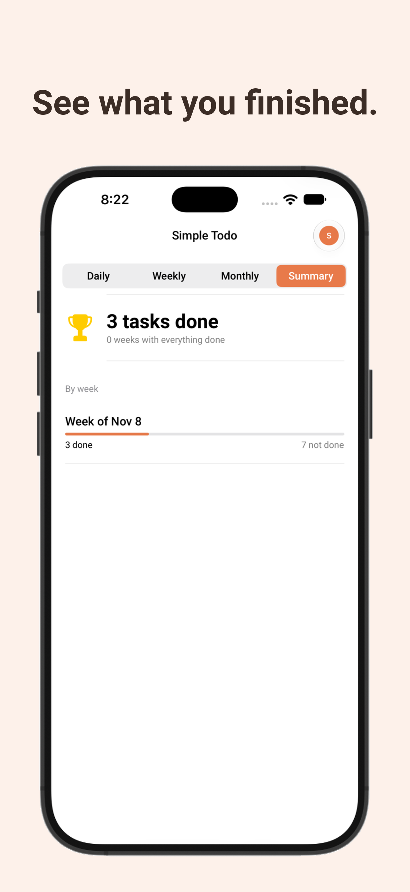
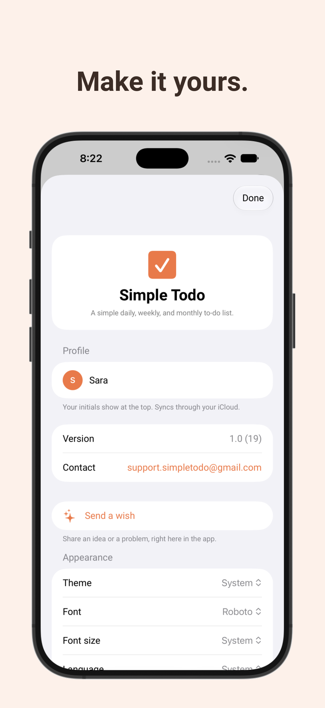
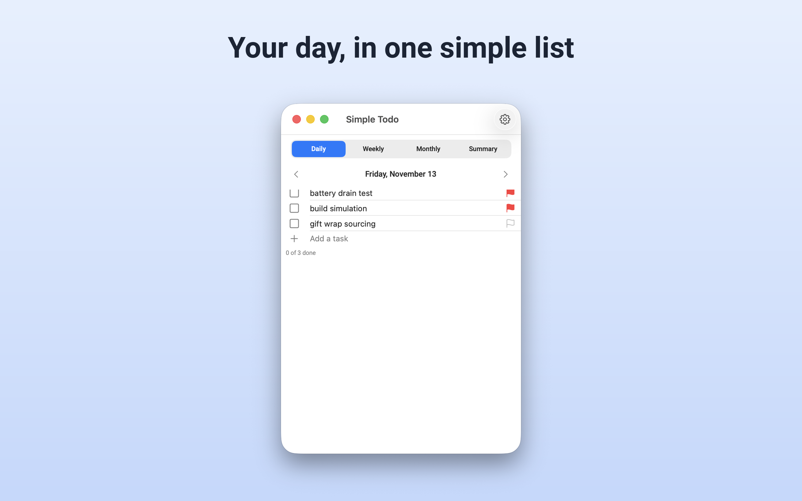

# Simple Todo: Daily Task — 功能說明

簡單的每日、每週、每月待辦清單，就像一本紙本小冊子。
可在 iPhone、iPad 和 Mac 上使用。

---

## 1. 你的清單：每日、每週、每月

- 點上方的「**每日**」、「**每週**」或「**每月**」。
- 點「**新增任務**」，輸入文字，按 Return 新增。
- 點左右箭頭 **‹ ›** 查看之前或之後的頁面。
- 清單下方會顯示完成數，例如「已完成 3 / 4」。

## 2. 完成就打勾

- 點任務旁的方框，會打勾並劃線。
- 再點一次可取消。
- 完成的任務會留在完成那天。

## 3. 沒做完的自動往前移

- 午夜一到，沒做完的任務會自動移動。
- 每日 → 隔天。每週 → 下週。每月 → 下個月。
- App 開著也會自動移動。

## 4. 緊急旗標（僅限每日）

- 點每日任務右邊的旗子，會變成紅色。
- 緊急任務會排到清單最上面。
- 再點一次紅旗即可移除。

## 5. 移動任務

- iPhone 或 iPad：長按任務。
- Mac：在任務上按右鍵。
- 選「**移至每日**」、「**移至每週**」或「**移至每月**」。
- 任務會移到該清單的最後面。
- 離開每日清單時，緊急旗標會被移除。

## 6. 編輯或刪除任務

- 編輯：點任務文字直接修改。
- 刪除：向左滑，再點「**刪除**」。或把文字全部刪掉。

## 7. 總結

- 點上方的「**總結**」。
- 看看總共完成了多少任務。
- 看每一週的已完成與未完成，過去的週也看得到。
- 上方會顯示幾週全部完成。

## 8. 設定

打開設定：
- iPhone 或 iPad：點右上角的圓形按鈕。
- Mac：選單「**Simple Todo → 設定…**」，或按 ⌘ 加逗號（⌘,）。

設定裡有：
- **個人資料 — 你的名字：** 名字縮寫會顯示在上方，並透過你的 iCloud 同步。
- **版本：** App 的版本。
- **聯絡我們：** 客服 Email。
- **許個願：** 直接在 App 裡分享想法或遇到的問題。
- **外觀：**
  - **主題：** 系統、淺色或深色。
  - **字體：** Roboto、Lato 或 Open Sans。
  - **字體大小：** 系統或自訂大小。
  - **語言：** 系統、English 或繁體中文。
- **贊助：** 自由贊助，不會解鎖任何功能。
- **iCloud 同步：** 顯示清單是否正在同步。

## 9. 裝置之間同步

- 每台裝置登入同一個 Apple ID，並打開 iCloud。
- 清單會自動同步。不用註冊，不用登入。
- 變更通常約一分鐘內出現在其他裝置。
- 可在「**設定 → iCloud 同步**」查看狀態。

## 10. 隱私

- 不用帳號。沒有廣告。沒有追蹤。
- 你的任務只存在你的裝置和你自己的 iCloud。
- 開發者看不到你的任務。
- 完整隱私權政策：https://sites.google.com/view/simpletodo-journipod/privacy-policy

## 11. 需要幫忙

- 在 App 裡：「**設定 → 許個願**」
- Email：support.simpletodo@gmail.com
- 支援頁面：https://sites.google.com/view/simpletodo-journipod/support

© 2026 Simple Todo by Journipod
